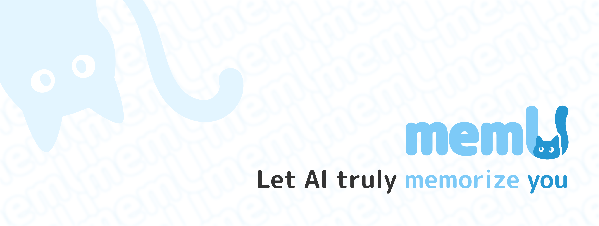
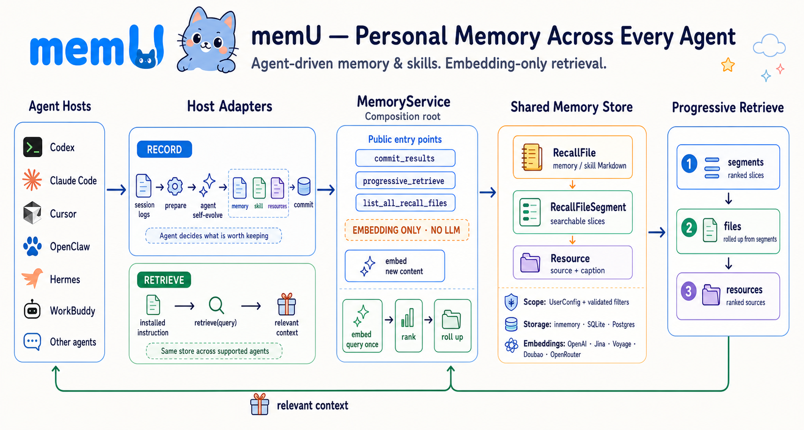
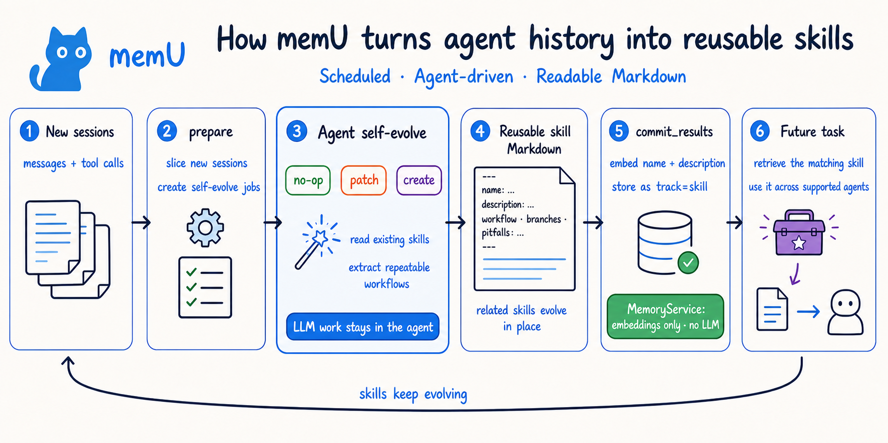

<div align="center">

# memU

### Personal memory, stored as Wiki

**Across Sessions. Across Agents. Across Devices.**

[](https://badge.fury.io/py/memu-cli)
[](https://opensource.org/licenses/Apache-2.0)
[](https://www.python.org/downloads/)
[](https://discord.com/invite/hQZntfGsbJ)
[](https://x.com/memU_ai)

<a href="https://trendshift.io/repositories/17374" target="_blank"></a>

</div>

---

memU is a lightweight, agent-driven memory system that gives users a shared LLM wiki across sessions, agents, and devices. It automatically distills your own reusable skills from your agent history. Its core memory logic is only 500 lines — compact enough to inspect, understand, and adapt.

## Documentation

Read the guides in [English](docs/site/index.md) or [简体中文](docs/site/zh/index.md).
They cover setup, host adapters, configuration, the service API, and troubleshooting.
To browse the site locally:

```sh
pnpm --dir docs install --frozen-lockfile
pnpm --dir docs dev
```

Requires Node.js 22.12+ and pnpm 11.15.1. Production build and preview commands are in the
[documentation guide](docs/site/development/documentation.md).

## Quick start

memU works with Codex, Claude Code, Cursor, OpenClaw, Hermes, WorkBuddy, and pi. See [Host adapters](#host-adapters-memory-for-desktop-coding-agents).

**Cross-device · Free · Unlimited · [View online](https://memu.so)**

Get your API key from [memu.so](https://memu.so), then send this message to your agent:

> Read [https://memu.pro/SKILL.md](https://memu.pro/SKILL.md), follow its instructions to install and configure memU, API Key is memu_•••••••••(get Api Key from memu.so).

## Agent support

This matrix lists the currently tested memU integrations by operating system.

- **Memorize** — capture useful session knowledge through a scheduled background task and turn it into reusable memory.
- **Retrieve** — bring relevant memory into a future task.
- **⚠️** — supported with an important limitation; see the user note.

### macOS

| Agent | Mode | Memorize | Retrieve | User note |
| --- | --- | :---: | :---: | --- |
| ChatGPT | ChatGPT(Work mode), codex and VS Code extension | ✅ | ✅ | |
| ChatGPT | Chat | ❌ | ❌ | Chat mode is not currently supported. Please use Work mode. |
| Claude Code | Desktop and CLI | ✅ | ✅ | If the selected model declines the setup steps, retry with **Opus** or another model. Sonnet 5 can occasionally do this. |
| Claude | Chat and Cowork | ❌ | ❌ | |
| Cursor | — | ✅ | ✅ | |
| OpenClaw | — | ✅ | ✅ | Retrieve support has not yet been verified. |
| Hermes Agent | — | ✅ | ✅ | |
| WorkBuddy | — | ✅ | ✅ | |

### Windows

| Agent | Mode | Memorize | Retrieve | User note |
| --- | --- | :---: | :---: | --- |
| ChatGPT | ChatGPT(Work mode), codex and VS Code extension | ✅ | ✅ | |
| ChatGPT | Chat | ❌ | ❌ | Chat mode is not currently supported. Please use Work mode. |
| Claude Code | Desktop and CLI | ✅ | ✅ | If the selected model declines the setup steps, retry with **Opus** or another model. Sonnet 5 can occasionally do this. |
| Claude | Chat and Cowork | ❌ | ❌ | |
| Cursor | — | ✅ | ✅ | |
| OpenClaw | — | ✅ | ✅ | |
| Hermes Agent | — | ✅ | ⚠️ | Use a memU version with Windows `HERMES_HOME` support; older versions may retrieve from the wrong files. |
| WorkBuddy | — | ✅ | ✅ | With Hy3, retrieval may fail. Retry with another model if this happens. |

### Linux

| Agent | Mode | Memorize | Retrieve | User note |
| --- | --- | :---: | :---: | --- |
| Codex | VS Code extension | ❌ | ✅ | |
| Claude Code | CLI | ✅ | ✅ | |
| OpenClaw | 4.23 / 7.1 | ✅ | ✅ | |

Support status reflects the current release and may change as host integrations evolve.

## How it works



## Automatic skill extraction

Once the scheduled bridging task is installed, memU can turn useful agent history into reusable Markdown skills automatically.



1. **Capture new sessions.** The host adapter reads new session history, including messages and tool calls.
2. **Prepare self-evolve jobs.** `prepare` slices each session into a self-contained job with the paths and context the agent needs.
3. **Let the agent decide.** The agent reads related existing skills, then chooses to do nothing, patch an existing skill, or create a new one.
4. **Write readable skill Markdown.** Each skill has a name, description, and reusable workflow, including useful branches, edge cases, and pitfalls.
5. **Commit and index.** `commit` submits changed skill files through `commit_results`; memU embeds the skill name and description and stores it under the `skill` track.
6. **Retrieve it later.** On a similar future task, memU returns the relevant skill so any connected agent can use the learned workflow.

The judgment and synthesis stay inside the agent. `MemoryService` makes no LLM or chat calls; it stores, embeds, and retrieves the skill Markdown the agent prepared.

## Self-hosted

**Private · Single-device · Embedding key required**

To run memU locally with your own storage and embedding provider, send this message to your agent:

> Read [https://raw.githubusercontent.com/NevaMind-AI/MemU/main/SKILL.md](https://raw.githubusercontent.com/NevaMind-AI/MemU/main/SKILL.md) and follow it to install memU.

## Upgrading from Cola or generic

The Cola and generic adapters, including `memu-cola` and `memu-agent`, have been
removed. **Before upgrading**, use the previous installation to print the guide
for each integration you installed:

```sh
memu-cola docs uninstall
memu-agent docs uninstall
```

Follow the applicable guide to disable and remove that integration's scheduled
tasks and managed retrieval instructions/skills. Verify ownership before deleting
files or scheduler entries, and preserve user-edited or unrelated content. Keep
the shared memory store, `~/.memu/config.env`, and tooling needed by other hosts.
Upgrading the package does not clean up integrations; leftover tasks and retrieval
instructions will call commands that no longer exist. If already upgraded, restore
your previous package version to complete cleanup first.

## Uninstall

To uninstall memU, send this message to your agent:

> Read [https://memu.pro/SKILL.md](https://memu.pro/SKILL.md) and follow its instructions to uninstall memU.

By default, uninstalling removes the host integration and tooling while keeping your memory store and `~/.memu/config.env`, so a later reinstall can resume where you left off. Memory is erased only when you explicitly ask for it.

## Host adapters: memory for desktop coding agents

memU runs as a sidecar to a desktop agent, one binary per host. Each binds two seams:

- **record** — a scheduled bridging task slices new session logs into self-contained job files; the agent itself distills them into memory/skill Markdown; `commit` submits whatever the agent left on disk back through `commit_results`.
- **inject** — a standing instruction in the host's instruction file tells the agent to run `<binary> retrieve` (→ `progressive_retrieve`) before answering.

| Host | Binary | Session log it mines | Instruction file it patches |
| --- | --- | --- | --- |
| Codex | `memu-codex` | `~/.codex/sessions/**/*.jsonl` | `~/.codex/AGENTS.md` |
| Claude Code | `memu-claude-code` | `~/.claude/projects/<project>/<session>.jsonl` | `~/.claude/CLAUDE.md` |
| Cursor (Agent/CLI) | `memu-cursor` | `~/.cursor/projects/<project>/agent-transcripts/**.jsonl` | `./AGENTS.md` (per project) |
| OpenClaw | `memu-openclaw` | `~/.openclaw/agents/<agentId>/agent/openclaw-agent.sqlite` (SQLite, read-only) + legacy `<agentId>/sessions/*.jsonl` | `~/.openclaw/workspace/AGENTS.md` |
| Hermes Agent | `memu-hermes` | `~/.hermes/state.db` (SQLite, read-only) | `~/.hermes/SOUL.md` |
| WorkBuddy | `memu-workbuddy` | `~/.workbuddy/projects/<project>/<session>.jsonl` | `~/.workbuddy/SOUL.md` |
| pi | `memu-pi` | `~/.pi/agent/sessions/<encoded-cwd>/<session>.jsonl` | `~/.pi/agent/AGENTS.md` |

Hosts not listed above are currently unsupported for new installations.

All hosts share one configured memory backend via `~/.memu/config.env` — local
or MemU Cloud. What one host's sessions taught memU, another host retrieves.

Installation is the one-message setup in [Quick start](#quick-start) or [Self-hosted](#self-hosted). [SKILL.md](SKILL.md) is the routing skill it hands your agent: identify your supported host, install the package, print that host's packaged install guide (`<binary> docs install`), and follow it — configure the memory backend, register the scheduled bridging task, patch the instruction file, each step behind a verify gate — then report which seams (memorization / retrieval) are now active.

Afterwards `<binary> doctor` proves the whole loop resolves: config, selected
mode, and a live retrieval.

Adding another host means implementing one `TranscriptSource` (where its session logs live, how its records are shaped) plus a `HostSpec`-sized CLI — the pipeline, verbs, and instruction text are shared.

## Developer integration

Use `memu memorize` to turn application-owned conversations into memory and skills.

## CLI

With memU Cloud, sign in at [memu.so](https://memu.so) to view your memory files. With a local installation, memory lives in the shared store configured by `MEMU_DB` in `~/.memu/config.env` — typically `~/.memu/memu.sqlite3` for local SQLite, or a Postgres DSN.

Once installed, your agent retrieves relevant memory automatically before answering.
To retrieve manually, run the adapter for your host:

```bash
memu-codex retrieve "What should I remember about this project?"
# or: memu-claude-code / memu-cursor / memu-openclaw / memu-hermes / memu-workbuddy / memu-pi
```

For pi installation, extension activation, background memory behavior, and the compact
retrieval output, see [Host adapters](docs/site/hosts/index.md).

Install or invoke the CLI directly:

```bash
uv tool install memu-cli     # isolated CLI install; uv manages Python
npx memu-cli --help          # CLI via npm launcher (engine: PyPI package memu-cli)
uvx --from memu-cli memu     # CLI via uv, no install
```

## Configuration

Values resolve in order: process env → `~/.memu/config.toml` → default. Host adapters
share the configured Local or Cloud backend. See [Configuration](docs/site/reference/configuration.md)
for backend selection, environment variables, embedding settings, and storage options.
Run `<binary> doctor` to verify the connection.

For direct Python integration, see [MemoryService](docs/site/reference/service.md).

## Community contributions

Explore the community tasks ([English](docs/community/tasks.en.md) / [简体中文](docs/community/tasks.md)) and claim a task in
[issue #790](https://github.com/NevaMind-AI/memU/issues/790). Each task has a stable
link, a difficulty rating, and acceptance criteria. See [CONTRIBUTING.md](CONTRIBUTING.md)
for development and PR guidelines.

## License

Apache-2.0


<sub>Partnership Community: <a href="https://linux.do">LINUX DO</a></sub>
