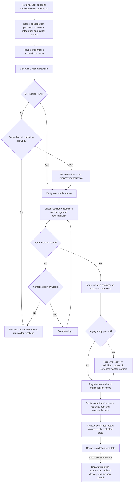

# Codex CLI installation contract

Status: implementation in progress. `memu-codex install` is not implemented yet.
The executable preparation slice is available as:

```sh
memu-codex prepare-cli --json
memu-codex prepare-cli --install-missing --json
memu-codex prepare-cli --codex /path/to/codex --json
```

The default performs discovery and startup verification only. Installation
requires explicit opt-in; no prompts occur. Results contain `stage`, `status`,
`executable` and either `version` or a diagnostic `reason` and `detail`.
Exit codes are 0 (passed), 2 (blocked), and 1 (failed). Authentication, hook
registration and migration are not included in this preparation result.

## Goal

A terminal user and an installation agent use the same `memu-codex install`
entry point. Installation code owns sequencing, mutations and completion checks.
The agent supplies inputs and explains results. Use the existing configuration,
doctor and dual-hook registration implementations.

## Stages

| Stage | Responsibility | Completion gate |
| --- | --- | --- |
| Inspect | Discover existing configuration, executables, hooks and legacy entries | Select fresh installation or migration; identify blockers before dependent mutations |
| Backend | Reuse or configure the memory backend through existing commands | Doctor succeeds; existing store and embedding identity are preserved |
| Host | Discover or install Codex; check startup, capabilities and background readiness | Verified executable and selected configuration can support background execution |
| Integration | Register retrieval and memorization handlers | Codex confirms both loaded and trusted, including asynchronous retrieval |
| Handoff | Finish applicable legacy migration and verify preserved state | Confirmed legacy entries are retired; protected data and unrelated integrations survive |

These are internal responsibility boundaries, not a requirement for five prompts.
Every stage reports passed, blocked or failed with a concrete next action.
Installation succeeds only when all applicable gates pass. Runtime retrieval
and successful memory commits have separate acceptance results.

Discover old workers before enabling replacement triggers. Migration must prevent
overlapping processing while validating replacement registration. If inventory,
ownership or safe handoff cannot be established, leave migration blocked.

## Planned end-to-end flow

The diagram describes the target `install` command. Only executable preparation
is added by this change; the remaining stages require subsequent implementation.
The user installs the memu-cli Python package before invoking this flow.



Any unmet required gate stops dependent actions with a blocked or failed result.
An unavailable legacy inventory is a blocker, not an empty inventory. Old workers
must be idle before enabling new triggers; retain recovery definitions until the
replacement is verified. Re-running inspects actual state rather than assuming a
previous stage remains valid. A background readiness probe is bounded and separate
from processing the user's real memory jobs.

## First implementation slice: prepare the Codex executable

1. Honor an explicit executable path; an invalid explicit selection is a blocker.
2. Otherwise search PATH, then CODEX_INSTALL_DIR if set or the official default
   installation directory for the current platform.
3. Reuse a found executable and check startup. A broken existing executable must
   produce a startup diagnostic, rather than being treated as missing.
4. If genuinely absent, require `--install-missing` before running the official
   native installer. This command does not prompt; the full installation entry
   point can collect the user's choice before calling this preparation function.
5. Execute the selected installer with visible diagnostics and a bounded wait.
   Failure or timeout blocks continuation; do not try unrelated package managers.
6. Rediscover the executable after installation, accounting for a stale parent
   PATH. Require successful startup and retain the resolved absolute path for
   registration. Installer exit zero alone is insufficient.

This slice changes no hook registration or legacy tasks. Dependency installation
is a recoverable preparation operation, not an installation failure event by
itself. Report a terminal blocker once; remote telemetry delivery never decides
whether installation can proceed.

## Following slices

- Check required Codex capabilities and authentication in the configuration home
  and environment selected for the eventual background worker. Distinguish
  missing authentication, unsupported capabilities and startup/provider errors.
  A version check or trusted hook does not establish successful model execution.
- Support interactive login and a clear noninteractive blocked result. An actual
  minimal model probe must have a timeout, disclose its possible cost, suppress
  memU recursion and avoid real prepare/commit work.
- Compose backend preparation, executable readiness and the existing
  `install-prompt-hook` implementation under `install`.
- Implement safe legacy handoff where the host exposes suitable management
  operations. Otherwise return an explicit blocker with supported next actions.
- Shorten INSTALL.md after the CLI owns the corresponding behavior.

## Executable scenario tests

Test behavior through actual implementation calls and subprocess boundaries,
using temporary homes and configuration. Substitute external installers and
Codex processes in ordinary CI; validate their real protocols separately.

| Case ID | Initial condition | Required observations |
| --- | --- | --- |
| codex.host.explicit | Explicit executable supplied | Use that executable; no alternative discovery or installation |
| codex.host.explicit-invalid | Explicit path invalid | Block; do not silently select another executable |
| codex.host.reuse | Working executable on PATH | Startup verified; installer never called |
| codex.host.stale-path | Existing executable only in installation directory | Discover and reuse; no duplicate installation |
| codex.host.missing | No executable found; installation accepted | Run selected installer, rediscover and verify absolute executable |
| codex.host.noninteractive-missing | No executable; no dependency-install opt-in | Return blocked promptly; no prompt or installer |
| codex.host.install-failed | Installer exits nonzero or times out | Block; no hook registration or legacy cleanup |
| codex.host.install-incomplete | Installer succeeds but executable remains absent or broken | Block; never claim readiness |
| codex.host.broken | Existing executable cannot start | Report startup failure; no automatic reinstall |

Extend the same approach to authentication, duplicate-free registration,
third-party preservation, retry after partial failure and migration. Preserve
formal/pending cursors, self-session records, recoverable jobs/results, logs,
shared configuration and memory throughout installation and upgrades.

Real acceptance records bind case ID/revision, memU commit/package, host version,
OS, selected configuration, result and evidence locations. Agent-guided runs
also record agent/model and the hash/source of the actual rendered guide.
Credentials must never enter evidence. A skipped or unobserved check is not a
pass. Repeatability in CI does not establish Desktop hook delivery or real login.
