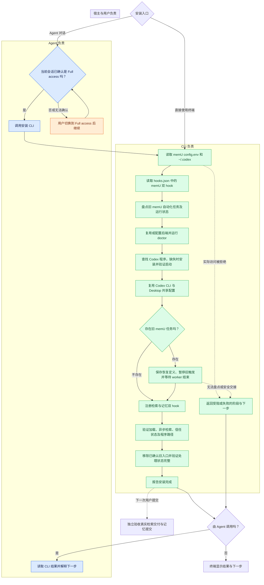

# Codex CLI 安装契约

状态：开发中。`memu-codex install` 尚未实现。本次提供程序准备命令：

```sh
memu-codex prepare-cli --json
memu-codex prepare-cli --install-missing --json
memu-codex prepare-cli --codex /path/to/codex --json
```

默认只查找程序并验证启动；显式传入 `--install-missing` 才允许安装，命令不会弹出交互提问。
结果包含 `stage`、`status`、`executable`，以及 `version` 或诊断字段 `reason`、`detail`。
退出码为 0（通过）、2（受阻）、1（失败）。共享配置接入、hook 注册和迁移需要后续步骤完成。

## 目标

终端用户与安装 Agent 使用同一个 `memu-codex install` 入口。
安装代码负责执行顺序、配置修改与完成判定；Agent 收集输入并解释结果。
复用现有配置、doctor 和双 hook 注册实现。

## 安装阶段

| 阶段 | 职责 | 通过条件 |
| --- | --- | --- |
| 检查现状 | 读取 memU config.env 和 ~/.codex，盘点 hooks.json 中的 memU handler 与旧 memU 任务 | 明确复用的配置、待注册入口和需交接的旧任务 |
| 准备后端 | 通过现有命令复用或配置后端 | doctor 通过，已有存储及 embedding identity 保留 |
| 准备宿主 | CLI 查找 Codex 程序，缺失时安装并验证启动，复用 ~/.codex 中的 CLI/Desktop 共享配置 | Codex 程序可启动，共享配置沿用 ~/.codex |
| 配置集成 | 注册检索与记忆 handler | Codex 确认两者已加载且受信任，检索支持异步 |
| 完成交接 | 迁移旧入口并验证保留状态 | 已确认的旧入口移除，处理状态及其他集成完整 |

这些是内部职责边界，不要求用户经历五次提问。
每阶段返回通过、受阻或失败，以及明确的下一步；所有适用门槛通过后才可报告安装完成。
用户提交后的真实检索交付与记忆提交属于独立运行验收。

## 目标全流程

用户先安装 memu-cli Python 包，再进入此流程。本次仅实现其中的程序准备部分。



蓝色表示 Agent 职责，绿色表示 CLI 职责，橙色表示用户操作。
颜色区分职责，不表示实现进度。本次已实现的是程序发现、可选安装及启动验证。

## 权限与交接边界

- Agent 调用安装 CLI 前，只确认当前会话已处于 Full access。
  未开启或无法确认时，提示用户切换；用户继续后重新确认有效模式，再调用 CLI。
- Full access 属于宿主会话属性，由 Agent 确认；CLI 负责实际安装操作的执行与结果检查。
- 直接终端调用跳过 Agent 权限检查。两条入口中的 CLI 都检查实际访问能力、报告操作失败并返回结构化结果，
  不修改调用方的沙箱或审批策略。
- Agent 调用应使用非交互选项；缺少必要输入时返回阻碍，由 Agent 解释。
  两条路径采用同一组安装完成条件。
- Codex CLI 与 Desktop 统一复用 `~/.codex` 中的共享配置及认证，注册的后台命令也使用该目录；
  从 CLI 安装时复用当前程序，从 Desktop 安装时由安装器发现或补装独立 Codex CLI。
- 目标流程沿用现有 Codex INSTALL.md 的 Full-access 前提。
- 所有必要门槛均须通过，才能执行依赖它的操作。无法盘点旧入口属于阻碍，不能当作入口不存在。
- 启用新触发前，旧 worker 必须空闲；保留恢复定义直到替代入口验证通过。
  无法确认归属或安全交接时暂停迁移。重跑时检查真实状态，不假定之前的阶段仍有效。
- 用户提交后的实际模型执行与记忆提交属于运行验收。

## 第一片：准备 Codex 程序

1. 优先使用显式指定的程序；指定无效时返回阻碍。
2. 否则先查 PATH，再查 CODEX_INSTALL_DIR；未设置时查当前平台的官方默认安装目录。
3. 找到后复用并检查启动；已有程序损坏时报告启动错误，不把它当作缺失。
4. 确实缺失时，必须有 `--install-missing` 才调用官方原生安装器。
   本命令不提问，完整安装入口以后可先收集用户选择。
5. 安装器输出诊断，并有执行时限；失败或超时立即停止，不自动尝试其他包管理器。
6. 安装后重新查找程序，处理父进程 PATH 未刷新的情况。验证启动成功，并保留绝对路径供注册使用。
   安装器退出码为零本身不足以证明程序就绪。

本片不修改 hook 或旧任务。依赖补装属于可恢复的准备操作，不应仅因发现缺失就上报安装失败。
最终阻碍只报告一次，遥测发送是否成功不影响本地安装判定。

## 后续切片

- 将 `~/.codex` 中的共享配置接入注册命令，验证双 hook 使用该目录和绝对程序路径。
- 将后端准备、程序准备和现有 `install-prompt-hook` 串入 `install`。
- 宿主提供适用管理接口时实现安全交接，否则返回明确阻碍与下一步。
- CLI 接管相应行为后，再精简 INSTALL.md。

## 可执行场景测试

通过真实实现调用与子进程边界检查行为，使用临时 home 和配置。
普通 CI 替代外部安装器与 Codex 进程，真实协议另外验收。

| 场景 ID | 初始条件 | 必须观察到的结果 |
| --- | --- | --- |
| codex.host.explicit | 显式指定程序 | 使用该程序，不另行发现或安装 |
| codex.host.explicit-invalid | 显式路径无效 | 返回受阻，不静默替换程序 |
| codex.host.reuse | PATH 上已有可用程序 | 验证启动，不调用安装器 |
| codex.host.stale-path | 程序仅存在于安装目录 | 能发现并复用，不重复安装 |
| codex.host.missing | 程序缺失且允许安装 | 调用选定安装器，重新发现并验证绝对路径 |
| codex.host.noninteractive-missing | 程序缺失且未授权安装 | 及时返回受阻，不提问、不安装 |
| codex.host.install-failed | 安装器失败或超时 | 停止，不注册 hook、不清理旧入口 |
| codex.host.install-incomplete | 安装器成功但程序仍缺失或损坏 | 返回受阻或失败，不报告就绪 |
| codex.host.broken | 已有程序无法启动 | 报告启动失败，不自动重装 |

后续用同样方式覆盖共享配置复用、注册去重、第三方配置保留、部分失败后重试及迁移。
安装与升级始终保留正式及 pending cursor、self-session 记录、待恢复任务与结果、日志、共享配置和记忆。

真实验收记录绑定场景 ID/修订、memU commit/包版本、宿主版本、OS、所选配置、结果和证据位置。
Agent 引导运行还记录 Agent/model，以及实际渲染引导的哈希与来源。证据不得包含凭据。
跳过或未观察到的检查不能记为通过；CI 可重复执行不代表 Desktop hook 交付或真实登录已验证。
