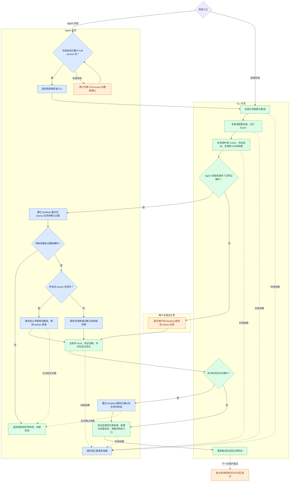

# Codex CLI 安装契约

`memu-codex install` 在 Python 中编排安装，终端和 Agent 使用同一组阶段实现。
CLI 负责配置、doctor、Codex 程序准备、双 hook 注册与回读。Desktop Agent 负责旧定时任务迁移。

```sh
# 终端安装：交互收集缺少的输入，连续显示阶段结果
memu-codex install

# 非交互安装：缺少输入时返回阻碍
memu-codex install --non-interactive --json

# Agent 逐阶段执行，在每次返回后汇报真实结果
memu-codex install --agent --non-interactive --json --stage 1
memu-codex install --agent --non-interactive --json --stage 2
memu-codex install --agent --non-interactive --json --stage 3
memu-codex install --agent --non-interactive --json --stage 4 --migration-evidence /path/to/migration.json
memu-codex install --agent --non-interactive --json --stage 5
```

`--stage N` 只执行一个阶段，要求前置阶段已通过；`--through-stage N` 从第一阶段连续执行到指定边界。
默认执行全部五阶段。退出码为 0（本次阶段通过）、2（受阻）、1（失败）。
`--json` 输出逐行 JSON，包含 `stage`、`title`、`status`；诊断和嵌套命令输出写入 stderr。
只有最后的 `complete: true` 表示 CLI 集成完成。迁移结果另外由 `migration` 标明。

## 两条安装路径

- 终端直接安装：提示用户到 Codex Desktop 暂停旧 memU 定时任务，随后继续安装。
  不要求迁移证据，完成结果记录 `migration: desktop_deferred`；旧任务的完整迁移交给 Desktop Agent。
- Agent 安装：先确认 Full access，使用 `--agent --non-interactive`。
  在第 4 阶段前完成旧任务盘点、归属确认、定义备份、暂停和 worker 空闲确认；
  第 4 阶段通过后删除已确认的旧任务并回读，第 5 阶段提交结果。
  清单未知、归属不明或操作未确认时返回受阻。

确认是新装且本地没有 automations 时，Agent 可使用 `--new-install`。
本地存在其他自动化任务时，应通过 Desktop 盘点后提交空的 memU 任务列表。
普通终端也可以显式传入迁移证据，执行完整交接检查。

## 阶段与职责

| 阶段 | CLI 执行 | Agent 补充工作 |
| --- | --- | --- |
| 🔐 [1/5] 检查安装条件 | 检查已有 hooks 格式，保存处理状态快照 | 确认会话 Full access |
| 📦 [2/5] 准备 memU 与记忆后端 | 复用或通过现有 config 命令配置后端，doctor 验证 | 收集缺少的后端选择和输入 |
| 🛠️ [3/5] 准备 Codex CLI | 查找程序、可选补装、验证启动并保存绝对路径 | 缺失时解释官方安装并提供补装选项 |
| 🔔 [4/5] 配置自动记忆与检索 | 检查适用的交接证据，注册双 hook，验证加载与信任 | 先暂停旧任务、等待 worker 结束 |
| ✅ [5/5] 完成交接与安装检查 | 检查证据连续性、后端与 hooks、受保护文件，清理旧检索入口 | 删除已确认旧任务并回读，汇报结果 |

Agent 在每个阶段前告知阶段标题，返回后及时说明真实结果，再执行下一阶段。
同步工具调用期间无法发言的宿主，使用 `--stage` 边界获得结果，不能把 stdout 刷新当成对话进度已交付。

## 流程

用户先安装 memu-cli 包。蓝色表示 Agent，绿色表示 CLI，橙色表示用户或宿主；颜色表示职责。



## 配置与程序准备

- 安装入口使用默认 `~/.codex`，沿用 CLI/Desktop 的共享配置和认证。
  新注册的检索与记忆命令也固定使用该目录。实际模型执行属于用户提交后的运行验收。
- 后端仍通过 `config_file` 的现有命令写入，保留其他宿主设置、注释和已有存储/embedding identity。
  新本地后端支持数据库、embedding provider/model/endpoint/key；Cloud 使用 memU key。
- 程序发现顺序：显式路径 → PATH → `CODEX_INSTALL_DIR` 或平台官方默认目录。
  无效显式路径和损坏程序返回诊断；确实缺失时，交互安装询问是否补装，非交互需 `--install-missing`。
- Python 调用官方 Windows PowerShell 或 Unix sh 安装器，限制下载大小、下载时间和执行时间。
  完成后重新发现程序并运行 `codex --version`，安装器退出零不足以判定程序就绪。
- `memu-codex prepare-cli [--codex PATH] [--install-missing] [--json]` 可独立用于程序准备诊断。

## Desktop 交接证据

独立 CLI 0.163.0 和 Desktop 内置 CLI 0.162.0-alpha.17.2 的帮助及实验 app-server 协议均未暴露
定时任务管理入口。Desktop 26.1007.9446.0 实际工具清单中 `automation_update` 提供
create/view/update/delete 和 ACTIVE/PAUSED；未提供列表工具，说明要求读取 automations 目录发现 ID。
本地文件不能自行证明完整清单。调查尚未验证真实创建、暂停、删除的完整闭环。

`--migration-evidence` 指向 Desktop Agent 保存的 JSON。所有引用文件均相对此 JSON 解析：

```json
{
  "version": 1,
  "source": "desktop",
  "inventory_complete": true,
  "inventory_evidence_file": "inventory.txt",
  "tasks": [{
    "id": "confirmed-owned-task-id",
    "owned": true,
    "paused": true,
    "idle": true,
    "definition_file": "definition.json",
    "pause_evidence_file": "paused.txt"
  }]
}
```

第 4 阶段检查 owned/paused/idle 声明、非空清单回读文件、定义备份及暂停证据文件。
注册通过后，Agent 才能删除旧任务。第 5 阶段还要求每项 `deleted: true` 和非空的
`delete_evidence_file`，并核对原任务 ID 和定义哈希连续性。检查完成的空清单使用 `tasks: []`。

这是有证据文件的 Agent 交接报告。CLI 验证报告格式和本地文件，不能独立认证远端 Desktop 状态；
真实性、盘点完整性和 worker 空闲观察由 Desktop Agent 负责，不能凭空填写布尔值。
宿主工具不可用或无法观察到结果时，Agent 路径保持受阻。

## 恢复与保护

安装状态写入宿主工作目录的 `install-state.json`，保存通过的阶段、已验证程序路径、Agent 模式、
交接文件位置、任务 ID/定义哈希、hook 配置哈希、后端配置哈希与原有处理文件哈希。
不保存后端凭据。阶段 5 从保存位置重新读取最新的删除证据。
完成后的普通重装重新检查，分阶段失败可使用 `--stage N` 重试失败阶段。

安装使用现有 `.diagnostic.lock` 与记忆 worker 互斥。所有阶段保留正式及 pending cursor、
self-session 记录、待处理任务、可恢复结果与日志；检测原有文件变化时保留现场并返回阻碍。
注册保留第三方 hook 和 Codex 用户配置，回读需要双 handler 已加载且 trusted，检索为异步。
最终阶段核对注册文件、后端配置、工作目录和受保护文件，再通过现有 `remove-instruction` 清理
managed pointer 和自有旧 skill；skill 归属不明或目录有额外文件时停止清理。

安装失败保留定义备份与处理状态。CLI 不恢复、删除或终止 Desktop 任务。成功事件由安装器发送，
遥测失败不影响结果。真实检索交付和记忆提交留给下一次用户消息验收。

## 可执行验收

`tests/test_codex_install.py` 检查真实阶段调用、退出码、操作顺序和磁盘结果；
`tests/test_codex_cli_prepare.py` 检查发现、补装、超时、重新发现与启动失败。
注册场景复用实际双 hook 实现，以替代 app-server 验证回读、去重、第三方配置保留和信任失败。
普通 CI 替代外部宿主、安装器和 backend；不据此宣称干净机器安装或真实 Desktop 任务迁移已通过。

真实验收需记录场景修订、memU commit/包版本、宿主版本、OS、结果及证据位置。
Agent 运行还记录 Agent/model，以及实际渲染引导的哈希和来源；证据不得含凭据。
未观察到的检查不能记为通过。
